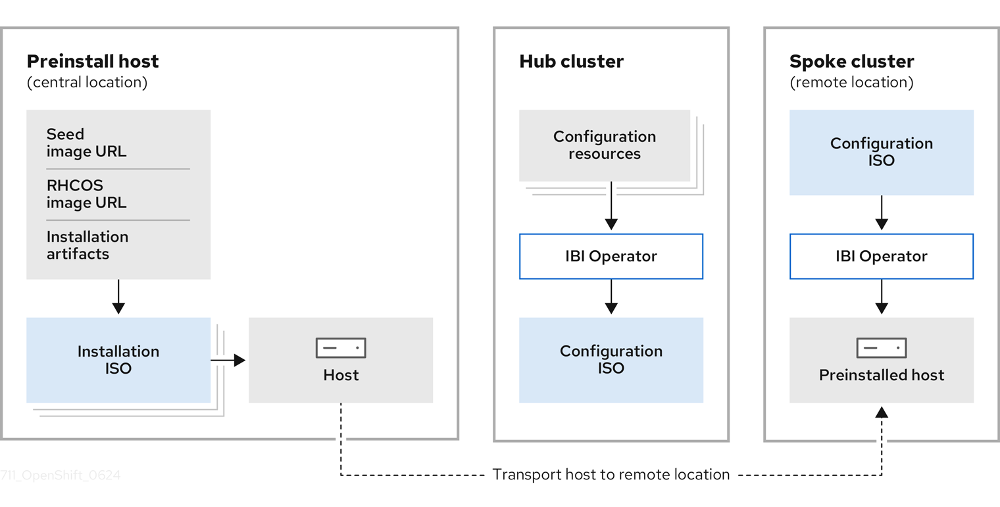

// Module included in the following assemblies:
//
// * edge_computing/image_base_install/ibi-understanding-image-based-install.adoc

:_mod-docs-content-type: CONCEPT
[id="ibi-installation-deployment-overview_{context}"]
= Overview of image-based installation and deployment for {sno} clusters

[role="_abstract"]
Deploying infrastructure at the far edge of the network presents challenges for service providers with low bandwidth, high latency, and disconnected environments.

It is also costly and time-consuming to install and deploy {sno} clusters.

An image-based approach to installing and deploying {sno} clusters at the far edge of the network overcomes these challenges by separating the installation and deployment stages.

.Overview of an image-based installation and deployment for managed {sno} clusters

Image-based installation::
Preinstall multiple hosts with {sno} at a central site, such as a service depot or a factory.
Then, validate the base configuration for these hosts and use the image-based approach to perform reproducible factory installs at scale by using a single live installation ISO.

Image-based deployment::
Ship the preinstalled and validated hosts to a remote site and rapidly reconfigure and deploy the clusters in a matter of minutes by using a configuration ISO.

You can choose from two methods to preinstall and configure your {sno} clusters.

Using the `openshift-install` program::
For a {sno} cluster, use the `openshift-install` program only to manually create the live installation ISO that is common to all hosts.
Then, use the program again to create the configuration ISO which ensures that the host is unique.
For more information, see _Deploying managed {sno} using the openshift-install program_.

Using the IBI Operator::
For managed {sno} clusters, you can use the `openshift-install` program with the Image Based Install (IBI) Operator to scale up the operations.
The program creates the live installation ISO and then the IBI Operator creates one configuration ISO for each host.
For more information, see _Deploying {sno} using the IBI Operator_.
